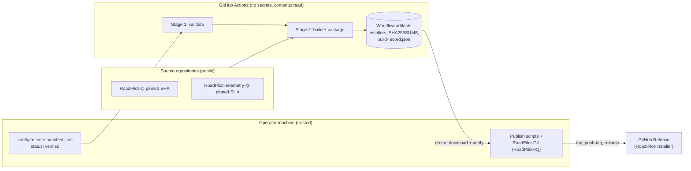
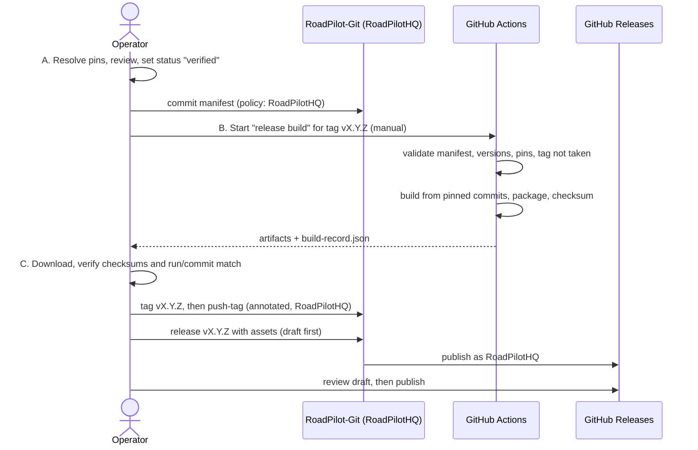

# Release pipeline architecture

> **Status: design only. Nothing in this document is implemented.** No build, packaging or release automation exists in this repository yet. The only implemented parts are the release manifest definition, its validator and the foundation CI ([architecture.md](architecture.md)).

How to read this document. Every statement is one of:

- **[Verified]**: observed in the actual repositories, configuration or tools while writing this document.
- **[Decision]**: an architectural choice proposed here.
- **[Assumption]**: believed but not verified. Each one is listed again in [Open questions](#12-open-questions-and-unresolved-decisions).

## 1. Executive summary

**Recommendation:** GitHub Actions builds, a local operator publishes.

- A **manifest-driven PowerShell layer** (`scripts/`) does the real work: validate the manifest, check out pinned commits, build, package, checksum. The same scripts run on a developer machine and in CI.
- A **GitHub Actions workflow** is the clean, auditable build environment. It runs the scripts on a fresh Windows runner with read-only permissions and no secrets, and stores the artifacts.
- **Publishing is a separate, manual stage on the operator's machine** through RoadPilot-Git (`tag`, `push-tag`, `release`) as `RoadPilotHQ`. It is not done by the Actions token.

Why publishing is not in CI: the repository policy allows only the `RoadPilotHQ` account to create tags and releases ([git-identity-policy.md](git-identity-policy.md)). A workflow using `GITHUB_TOKEN` would publish as `github-actions[bot]`, which breaks that policy. Storing a `RoadPilotHQ` personal access token as a secret would put a powerful credential into build infrastructure that executes third-party-controlled build scripts. Keeping publishing local keeps the policy intact and the build job secret-free. The cost is one manual step per release, which is acceptable for a small project.

Prerequisite gap: RoadPilot-Git's `release` command currently creates a release with notes only and **cannot upload assets** [Verified]. Asset upload must be added to RoadPilot-Git before the first real release (phase 2F).

## 2. Goals and non-goals

### Goals

1. A release is fully described by one verified manifest: the same manifest always selects the same source revisions.
2. Builds run from pinned commits only, in a controlled and recorded environment.
3. Every artifact is traceable to the manifest, the source commits, the toolchain and the workflow run.
4. Validation, building and publishing are separate stages with separate permissions.
5. A failed stage never leaves a published tag or release behind.
6. The process works for a small project: few moving parts, runnable locally, no mandatory external service.

### Non-goals

- Implementing any build or release automation (this phase is documentation only).
- Changing the manifest schema (explicitly out of scope for this phase; see [section 12](#12-open-questions-and-unresolved-decisions) for what it cannot express).
- Distributing every RoadPilot component. Which components ship is decided per release by the manifest.
- Code signing, auto-update and non-Windows platforms (undecided; Windows x64 only for now).
- Claiming that anything has been tested in a game.

## 3. Current project and dependency overview

### Repositories (verified on 2026-11-08)

All eight repositories checked are **public** [Verified via the GitHub API]: RoadPilot, RoadPilot-Telemetry, RoadPilot-Map, RoadPilot-Language, RoadPilot-Plugin, RoadPilot-SDK, RoadPilot-Visualization, RoadPilot-Installer. No repository other than the Installer has a GitHub Actions workflow [Verified]. No repository contains a LICENSE file [Verified]; RoadPilot-Map records this as an open question.

| Repository | What it actually contains | Build system [Verified] | Build input of the RoadPilot app? |
|---|---|---|---|
| `RoadPilot` | Tauri 2 desktop app, React/TypeScript frontend | npm (Node `>=22.12.0`, `package-lock.json`), Vite, Cargo (`rust-version = "1.90"`, edition 2024, no `rust-toolchain` file), `tauri build` via `npm run desktop:build` | It is the app |
| `RoadPilot-Telemetry` | `client/`: Rust crate `roadpilot-telemetry-client`; `plugin/`: C++17 SCS game plugin (CMake) | Cargo; CMake (needs the SCS SDK via `SCS_SDK_ROOT`) | **Yes**: `src-tauri/Cargo.toml` depends on the client crate as a git dependency pinned by `rev = ca64c8e7e169a26143c62b2c525de3e8ec3b39ab`, and `Cargo.lock` records the same revision |
| `RoadPilot-Map` | Rust workspace of 7 crates, CLI `roadpilot-map` | Cargo, `rust-toolchain.toml` pins `1.97.1`, `cargo deny` | **No dependency found** in RoadPilot's `package.json`, `Cargo.toml` or `vite.config.ts` |
| `RoadPilot-Language` | README only; "early planning", no source code | none | No. Nothing to build. RoadPilot bundles English itself and names this repository as a future home |
| `RoadPilot-Plugin` | README only; "early planning", no source code | none | No. Nothing to build |
| `RoadPilot-SDK` | C++ SCS Input API plugin (prototype), CMake | CMake, needs SCS SDK 1.16 via `SCS_SDK_ROOT`, Windows x64 only | **No**: the README states it is not connected to the application |
| `RoadPilot-Visualization` | Vite/React app (separate), reads a local WebSocket bridge | npm (Node `>=22.12.0`), Vite | **No build dependency found**: RoadPilot only mentions a read-only WebSocket bridge to it |

Consequences:

- The only **verified** build dependency is `RoadPilot -> RoadPilot-Telemetry` (client crate). That matches the single dependency recorded in `config/release-manifest.example.json`.
- `RoadPilot-Language` and `RoadPilot-Plugin` cannot be built or shipped today.
- `RoadPilot-Map`, `RoadPilot-Visualization` and the two C++ plugins are **independent deliverables**, not inputs to the app. Whether any of them ships with a release is an open product decision, not an architectural given.
- At the time of Phase 2A the example manifest listed `map`, `language` and `visualization` in `buildOrder` without any verified dependency, although the validator requires every listed repository to appear in `buildOrder`. A real release manifest must list only repositories that are actually part of that release. **Resolved in Phase 2B.1:** the example now lists only `telemetry` and `roadpilot`.

### Facts that shape the design

- **[Verified]** The RoadPilot version appears in three files, all `0.1.0`: `package.json`, `src-tauri/Cargo.toml`, `src-tauri/tauri.conf.json`.
- **[Verified]** `tauri.conf.json` sets `bundle.targets` to `"all"`. On Windows that selects more than one installer format and downloads bundler tools at build time. The set of formats a release should ship is undecided.
- **[Verified]** No release bundle has been built locally: `src-tauri/target/release/bundle` does not exist (only a debug build directory). A release-mode `tauri build` has therefore **not been verified** on this machine, let alone in CI.
- **[Verified]** The local toolchain is Rust 1.97.1, Node v24.19.0. RoadPilot-Map pins Rust 1.97.1; RoadPilot declares only a minimum (1.90).
- **[Verified]** The Telemetry and SDK plugins have been tested only with automated tests and a fake host. The Telemetry README says the schema 2 plugin has not been tested in ATS, and ETS2 is not live-tested. The SDK README says nothing there has been tested in ATS or ETS2. This pipeline makes **no** claim that any game integration works.
- **[Verified]** RoadPilot-Git has `tag`, `push-tag` and `release` commands restricted to repositories with an `accountPolicy`; the Installer's policy makes `RoadPilotHQ` the only account. `release` requires `gh` logged in as `RoadPilotHQ`, and it has no asset upload. `gh` on this machine is currently logged in as `RoadPilotHQ`.
- **[Verified]** Real GitHub release publishing has never been run or tested through RoadPilot-Git (only with a fake `gh`).

## 4. Proposed architecture

### Approaches considered

| Approach | Strengths | Weaknesses | Verdict |
|---|---|---|---|
| **A. GitHub Actions as orchestrator, thin PowerShell scripts do the work, local publish** | Clean, recorded build environment; no extra service; scripts also run locally; publishing stays under the account policy | One manual publish step; depends on GitHub-hosted runners | **Recommended** |
| B. Reusable workflows per component repository | Each repo owns its build | No repository has any CI today; changes six repositories; cross-repo version coupling; large effort for a small project | Rejected for now; revisit if components start releasing independently |
| C. Everything local in PowerShell | Simple, full control, no runner dependency | Not a clean environment; weak traceability; "works on my machine" risk | Rejected as the only path. It remains the way to develop and debug the scripts |
| D. Publish from CI | Fully automated | Publishes as `github-actions[bot]` (policy violation) or needs a `RoadPilotHQ` token in CI | Rejected |
| E. Hardcoded repository list in scripts | Fewest moving parts | A second source of truth next to the manifest; pins can drift | Rejected for repository, pin and order data |
| F. Manifest-driven | One source of truth, matches the existing schema and validator | The schema has no build commands or toolchain fields | **Recommended for repositories, pins and order**; build steps live in scripts keyed by repository id (see below) |

### Decision: manifest selects, scripts build

- **[Decision]** The manifest decides *which* repositories, at *which* commits, in *which* order. Scripts decide *how* each repository is built. The scripts contain one small build recipe per known repository id (initially `telemetry` verification and `roadpilot`). An id without a recipe makes the pipeline **fail closed**, so a manifest cannot silently add an unbuildable component.
- **[Decision]** Scripts are the unit of logic; workflows only call them. Anything a workflow does must also be runnable locally with the same script.
- **[Decision]** Three stages with separate permissions: **validate**, **build**, **publish**.

### Component view

## 5. Release lifecycle

### A. Release preparation

- **Initiation [Decision]:** a release starts when the operator commits a verified `config/release-manifest.json` whose `release.version` is the intended version (for example `1.0.0`, tag `v1.0.0`). Nothing else triggers a release.
- **Manifest selection [Decision]:** exactly one file, `config/release-manifest.json`. It must have `status: "verified"`; the example is never accepted (`Test-ReleaseManifest.ps1 -RequireVerified`, already implemented).
- **Resolving revisions [Decision]:** a read-only helper (planned, phase 2B) proposes a draft manifest with the current commit of each repository, **never** writing `verified` itself. The operator reviews and confirms. Mutable references (branches) are never recorded as pins; this is already enforced by the validator.
- **Missing or invalid dependencies [Decision]:** the pipeline stops. A pinned commit that does not exist in the repository, a repository without a build recipe, or a declared dependency missing from the manifest are errors, never warnings.
- **Version consistency [Decision]** (all checked before building, by a planned script):
  1. `release.version` is SemVer and the requested tag equals `v<release.version>`.
  2. The RoadPilot version in `package.json`, `src-tauri/Cargo.toml` and `src-tauri/tauri.conf.json` at the pinned commit all equal the `roadpilot` entry's `version` in the manifest.
  3. The `rev` that `RoadPilot/src-tauri/Cargo.toml` gives `roadpilot-telemetry-client` and the revision in its `Cargo.lock` both equal the `telemetry` pin in the manifest. This matters because Cargo fetches that dependency by itself; without this check the manifest pin would be decoration, not a guarantee.
  4. Each pinned commit exists and is reachable from the default branch of its repository (so pins cannot point to throwaway commits).
  5. The tag does not exist locally or remotely.
  6. `release.version` has not been released before.

## 6. Build orchestration

- **What is checked out [Decision]:** the Installer itself (the commit that carries the manifest), plus every repository listed in the manifest, each at its pinned commit, into an isolated work directory. `git clone` followed by `git checkout --detach <sha>`, then `git rev-parse HEAD` must equal the pin. Clones use plain HTTPS because the repositories are public; the build needs no SSH key and no token.
- **Order [Decision]:** `buildOrder` from the manifest; the validator already guarantees dependencies come first. For the verified dependency graph this means: verify Telemetry at its pin, then build RoadPilot.
- **How the Telemetry pin is used [Decision]:** RoadPilot's own `Cargo.toml` fetches the client crate by revision. The Installer does **not** patch RoadPilot to point at a local checkout, because that would build something other than the source at the pinned commit. The Telemetry checkout is used to verify that the pin exists and matches (check 3 above) and, in a later phase, to build the Telemetry plugin if it is added to a release.
- **Tooling and environment [Decision]:**
  - Runner: `windows-2022` (a pinned runner label, not `windows-latest`). [Assumption: this image provides the MSVC build tools and the WebView2 prerequisites needed for a Tauri build; to be verified in phase 2E.]
  - Node: the major version from `engines` (`>=22.12.0`); the exact version is set in a pin file owned by the Installer (see open questions). Dependencies installed with `npm ci` from `package-lock.json`.
  - Rust: RoadPilot declares only a minimum (1.90), so the Installer must pin the exact toolchain itself (a new, small pin file, not the manifest) and record it. Candidate: the version already used locally and by RoadPilot-Map (1.97.1). Cargo is run with `--locked`.
  - Tauri CLI: taken from the `@tauri-apps/cli` dev dependency in `package-lock.json`, never installed globally.
  - Third-party actions are pinned by commit SHA; first-party `actions/checkout` is pinned by SHA too (the current foundation workflow uses a tag, to be tightened in phase 2E).
  - Every tool version actually used is written to the build record.
- **Checks before packaging [Decision]:** `npm run check` and Rust tests of RoadPilot at the pinned commit. A failing check stops the build; there is no "continue on error".
- **Failed builds [Decision]:** the stage fails, no artifact is marked releasable, logs are kept as workflow artifacts, and nothing is tagged or published. Failures are fixed by a new commit and a new manifest, never by re-pinning around the failure silently.

## 7. Artifact structure

Planned and **not produced yet**. Names are proposals.

| Artifact | Notes |
|---|---|
| Windows installer(s) from `tauri build` | Which formats ship (`bundle.targets` is `"all"` today) is undecided |
| `SHA256SUMS` | SHA-256 of every release file |
| `release-manifest.json` | Exact copy of the verified manifest used |
| `build-record.json` | New file generated by the build (schema to be defined in phase 2D): manifest SHA-256, Installer commit, source commits as actually checked out, tool versions, runner image, workflow run id, start/end time, file list with SHA-256 |

- **Naming [Decision]:** `RoadPilot-<version>-windows-x64.<ext>`, for example `RoadPilot-1.0.0-windows-x64-setup.exe`. The tag is `v<version>`.
- **Storage during the build [Decision]:** GitHub Actions workflow artifacts (no external service). Retention is set explicitly rather than left at the default.
- **Integrity [Decision]:** `SHA256SUMS` is created in CI and re-verified on the operator machine before publishing, and the same file is attached to the release for end users. GitHub artifact attestations (build provenance) are an optional addition. [Assumption: they are available for this public repository; to be verified in phase 2E.]
- **Association with sources [Decision]:** `build-record.json` plus the attached manifest link every file to the manifest and to the exact commits. The build record is generated from what was actually checked out, not copied from the manifest, so a mismatch is detectable.
- **Not decided:** code signing. An unsigned Windows installer triggers SmartScreen warnings; this must be decided before a public stable release.

## 8. Release publishing

All steps run on the operator machine, as `RoadPilotHQ`, through RoadPilot-Git. No step uses plain `git push`, `git tag` or `gh release`.

1. **Download and verify.** A script downloads the artifacts of one specific workflow run with `gh run download`, verifies `SHA256SUMS`, checks that `build-record.json` agrees with the manifest, and checks that the run was built from the Installer commit that is on `origin/main`.
2. **Tag.** `roadpilot-git.ps1 tag -TagName vX.Y.Z -MessageFile ...` creates an annotated tag by `RoadPilotHQ` on that Installer commit, then `push-tag`. Existing local or remote tags are never overwritten [Verified, RoadPilot-Git behaviour]. The tag is created only after a successful build, so a failed build leaves no tag.
3. **Release notes [Decision]:** generated by a script from the manifest (versions and pinned commits per repository, with links) plus a hand-written summary file reviewed by the operator. No unverified compatibility or game-testing claims are generated; the template states the testing status explicitly.
4. **Draft first [Decision]:** the release is created as a draft with the assets, reviewed on GitHub, then published. [Requires RoadPilot-Git `release` to upload assets and support drafts. `-Draft` exists; **asset upload does not yet** [Verified]. Planned as phase 2F in RoadPilot-Git.]
5. **Account policy [Verified mechanism]:** `release` stops unless `gh` is logged in as `RoadPilotHQ`, and the Installer policy forbids the other three accounts.
6. **Preventing duplicate or wrong releases [Decision]:**
   - the tag must not exist (checked at build start, at tag time, and by RoadPilot-Git);
   - a release for the tag must not exist (checked by RoadPilot-Git `release`);
   - the manifest must be `verified` and its version must equal the tag;
   - assets must match the verified checksums;
   - the release is made from one specific workflow run id recorded in the release notes;
   - a release is never edited by re-running the pipeline: corrections ship as a new version.

## 9. Security model

### Stages and permissions

| Stage | Trigger | Permissions | Secrets | Runs untrusted code? |
|---|---|---|---|---|
| Validate (exists today as the foundation check) | push, pull request | `contents: read` | none | No |
| Build | manual (`workflow_dispatch`) with the tag as input | `contents: read` (plus `id-token` / `attestations: write` only if attestations are adopted, and only in this job) | none | **Yes** (build scripts of pinned repositories) |
| Publish | operator, locally | n/a (the operator's `RoadPilotHQ` session) | the operator's own SSH key and `gh` login; nothing stored in GitHub | No |

- **Untrusted revisions:** a build executes code from the pinned repositories (npm scripts, Cargo `build.rs`, proc macros). Mitigations: the validator accepts only `https://github.com/RoadPilotHQ/<name>.git` URLs; pins are full commit SHAs reviewed by the operator in the manifest commit; the build job has no secrets and a read-only token; checkouts do not persist credentials; dependencies come only from lockfiles (`npm ci`, `cargo --locked`). Whether to disable npm lifecycle scripts is open (it may break the toolchain).
- **Supply chain:** the lockfiles pin dependency versions; `cargo deny` is already used by RoadPilot-Map and is a candidate for RoadPilot.
- **Pull requests from forks:** the build workflow is never triggered by `pull_request`, so untrusted contributors cannot run it.
- **Secrets [Decision]:** none in the first versions. A future code-signing certificate would live only in a protected GitHub environment used by a dedicated signing job, never in the build job, and only after a separate decision.
- **SSH:** CI needs none (public repositories). SSH is used only locally by RoadPilot-Git, with the `RoadPilotHQ` key, as today. No private key ever goes into GitHub.
- **Account policy:** unchanged. Commits, pushes, tags and releases for this repository are `RoadPilotHQ` only, never randomly selected [Verified, [git-identity-policy.md](git-identity-policy.md)].
- **Separation:** validation cannot publish; the build cannot publish (no write token, no `RoadPilotHQ` credential); publishing consumes only checksum-verified artifacts.
- **Reproducibility and traceability:** pinned commits, lockfiles, pinned runner label and toolchain, recorded tool versions, `build-record.json`, SHA-256 sums. Bit-for-bit reproducible installers are **not** promised (bundlers embed timestamps and downloaded tools); the guarantee is traceability, and bit-identical output is an open question.

## 10. Error handling and recovery

| Failure | Handling |
|---|---|
| Manifest invalid or not `verified` | Stage 1 fails before any checkout; fix the manifest |
| Pin unreachable, version mismatch, Cargo `rev` differs from the manifest pin | Build stops with a precise message; no artifacts |
| Dependency install or compile fails | Build fails; logs kept; nothing tagged; fix and start a new run |
| A check fails (`npm run check`, tests) | Build fails; never skipped |
| Runner or network trouble | Re-run the same workflow for the same tag; the result is accepted only if the new `build-record.json` agrees with the manifest |
| Checksum mismatch at publish | Abort; discard the download; nothing tagged |
| Tag created but release failed | The tag stays (RoadPilot-Git never overwrites or deletes it). Fix the cause and publish the release for the **same** tag; if the tagged commit is wrong, release the next version and leave the tag |
| Wrong release published | Mark it as pre-release or delete the **release** (not the tag) and publish a corrected next version. Rewriting a published tag is not done |
| Required account or `gh` login unavailable | Hard stop; no fallback to another account |

## 11. Implementation phases

Each phase is a separate, reviewable change with its own commit and push as `RoadPilotHQ` through RoadPilot-Git. Nothing starts before the previous dependency is complete.

### Phase 2B: Manifest resolution and consistency checks (read-only)

- **Objective:** make the manifest trustworthy before anything is built.
- **Deliverables:** a script that drafts pins from local repositories (always `UNRESOLVED`-safe, never `verified`); a script implementing the checks in section 5 (versions, Cargo `rev` equals pin, reachability, tag free); tests with fixtures; decision on how the example manifest is corrected.
- **Depends on:** none.
- **Validation:** tests for each failure mode; run against the real repositories read-only.
- **Done when:** all section 5 checks pass or fail correctly on fixtures, a draft manifest can be generated, no repository is modified.

### Phase 2C: Build environment definition and local RoadPilot build

- **Objective:** know that RoadPilot actually builds in release mode, reproducibly, outside the developer's working tree.
- **Deliverables:** toolchain pin file (Node, Rust); a build script that clones the pinned RoadPilot commit into a work directory, runs `npm ci`, `npm run check`, `cargo test --locked`, and `npm run desktop:build`; a decision on `bundle.targets`.
- **Depends on:** 2B.
- **Validation:** the script runs on a developer machine from a clean directory; the installer file exists.
- **Done when:** a release-mode installer is built from a pinned commit by one script. This is the first time a release build is verified; the installer is **not** tested in a game.

### Phase 2D: Artifacts, checksums and build record

- **Objective:** make outputs traceable and verifiable.
- **Deliverables:** artifact naming implementation; `SHA256SUMS`; `build-record.json` and its schema; a verifier script.
- **Depends on:** 2C.
- **Validation:** tamper tests (changed file, changed manifest, wrong commit) must be detected.
- **Done when:** the verifier accepts a genuine build and rejects each tampered case.

### Phase 2E: CI build workflow (no publishing)

- **Objective:** repeat the build in a clean, recorded environment.
- **Deliverables:** manual workflow that calls the scripts; read-only permissions; actions pinned by SHA; artifact upload with explicit retention; decision on attestations; foundation workflow tightened the same way.
- **Depends on:** 2D.
- **Validation:** a run on a verified manifest produces artifacts whose `build-record.json` verifies; a run with a bad manifest fails before building; the workflow contains no write permission, tag or release step (extending `Test-Foundation.ps1`).
- **Done when:** a CI run and a local run agree on sources and tool versions, and the artifacts pass the verifier.

### Phase 2F: RoadPilot-Git release asset upload (in RoadPilot-Git, not this repository)

- **Objective:** let the policy-controlled `release` command attach assets.
- **Deliverables:** asset upload and checksum-file support in `release`; tests with the fake `gh`; documentation.
- **Depends on:** none (can run in parallel with 2B to 2E).
- **Validation:** the existing RoadPilot-Git tests plus new asset tests pass; policy behaviour unchanged.
- **Done when:** `release` uploads listed files only after the existing account and tag checks pass. It still does not publish anything real in tests.

### Phase 2G: Publish tooling

- **Objective:** a safe, repeatable publish step.
- **Deliverables:** script to download a run's artifacts, verify them, check the Installer commit, generate release notes, and drive `tag`, `push-tag`, `release` (draft first); dry-run mode.
- **Depends on:** 2D, 2E, 2F.
- **Validation:** end-to-end dry run; refusal tests for existing tag, existing release, checksum mismatch, wrong account.
- **Done when:** the dry run completes against real artifacts without creating any tag or release.

### Phase 2H: First alpha release rehearsal

- **Objective:** verify the real GitHub release path once, with the lowest risk.
- **Deliverables:** one `alpha` draft release created end to end; a written result; decisions on code signing and shipped components.
- **Depends on:** 2G and the open decisions it needs.
- **Validation:** the draft contains the expected assets and notes, authored by `RoadPilotHQ`; checksums verify after download.
- **Done when:** the path is proven or its problems are documented. Until then, real publishing remains **unverified**.

Later, only after separate verification and decisions: building and shipping the Telemetry and SDK plugins (needs the SCS SDK and a licensing answer), shipping RoadPilot-Map, localization bundles once code exists, signing, update channel.

## 12. Open questions and unresolved decisions

1. **Schema limits.** The current manifest cannot express toolchain versions, artifact lists, per-repository build steps or the distinction "build input" versus "distributed component". This document works around that with scripts and a separate build record. Whether a future schema version should add these fields is undecided and was out of scope here.
2. **Example manifest.** *Resolved in Phase 2B.1:* the example now contains only the two verified build inputs. Adding further components still needs verified relationships and, for roles such as "shipped component", a schema decision.
3. **Which components ship.** Only the RoadPilot app is a verified deliverable. Shipping the Telemetry plugin, the SDK input plugin, the Map CLI or the Visualization app is undecided.
4. **SCS SDK.** Both C++ plugins need the SCS SDK, which is not in the repositories. Whether a CI build may obtain and use it, and whether built plugins may be redistributed, is **unknown**.
5. **Licensing.** No repository has a license (Map documents this as an open question). This blocks any public distribution decision.
6. **Code signing.** Not decided: certificate, cost, and where signing would run.
7. **Bundle formats.** `bundle.targets: "all"` pulls in extra tools at build time. Which formats to ship is undecided.
8. **Toolchain pins.** Exact Node and Rust versions, and where the pin file lives. Candidate Rust 1.97.1 is the currently installed and RoadPilot-Map version, not a tested requirement of RoadPilot.
9. **Runner image.** Whether `windows-2022` contains everything a Tauri build needs is unverified.
10. **Release location.** Releases are planned in RoadPilot-Installer. Whether the RoadPilot repository should also carry release pages is undecided.
11. **Attestations.** Availability and value of GitHub build provenance for this repository is unverified.
12. **npm lifecycle scripts.** Whether `npm ci --ignore-scripts` is compatible with the Vite/Tauri toolchain is unverified.
13. **Bit-for-bit reproducibility.** Not expected; whether it is wanted is open.
14. **Retention and storage.** Workflow artifact retention period, and whether a long-term archive is needed beyond GitHub Releases.
15. **Release notes content.** The exact template, and how testing status of game integrations is stated, needs review.
16. **Game testing.** No part of this pipeline tests RoadPilot, the plugins or the map data in ATS or ETS2. Any such claim needs separate, documented manual testing.
